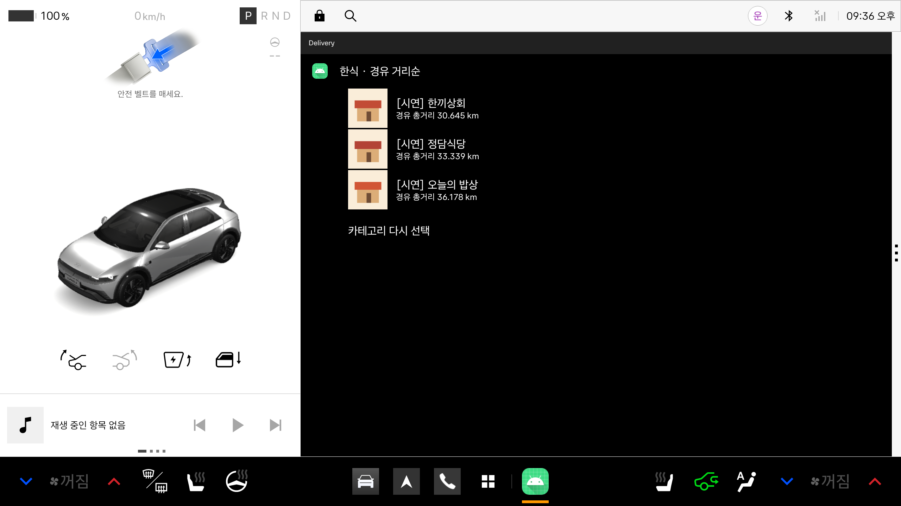
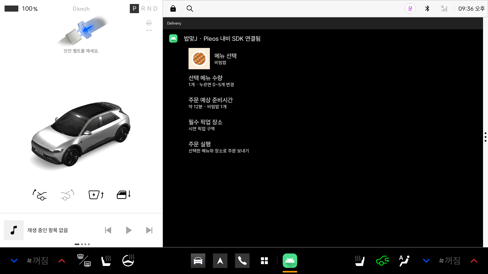
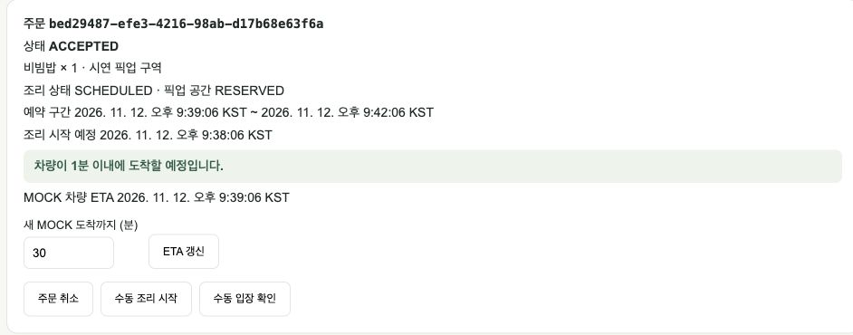
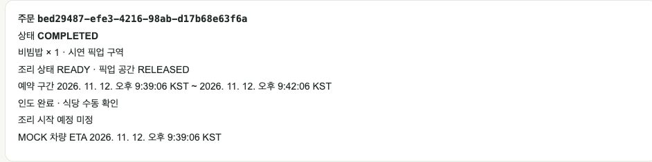
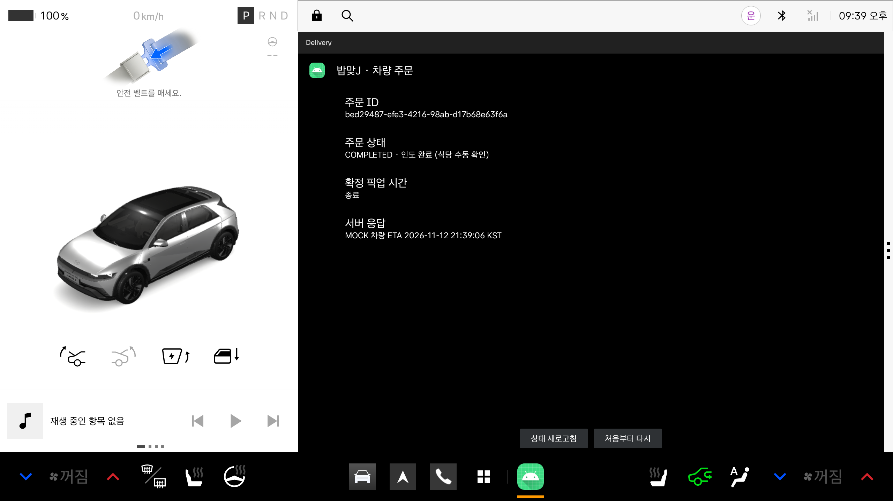

# 밥맞J 픽업 시연

2026년 11월 12일, 식당과 음식 이미지를 확대한 Pleos 차량 앱에서 **[시연] 한끼상회의 비빔밥 1개**를 주문했다. 식당 웹에서 같은 주문을 수락하고 조리, 차량 입장, 음식 인도까지 진행했다.

- 주문 ID `bed29487-efe3-4216-98ab-d17b68e63f6a`
- 최종 목적지 **강남역 2호선**
- 픽업 장소 **한끼상회 시연 픽업 구역**

## 1. 목적지를 정하고 식당을 고른다

Pleos 내비에서 강남역 2호선을 목적지로 정했다. 밥맞J에서 **내비 위치·목적지 불러오기**를 누른 뒤 한식 카테고리를 선택했다. 식당 목록에는 확대된 식당 이미지와 픽업 장소를 경유하는 총 주행거리가 표시됐다. **한끼상회 30.645 km → 정담식당 33.339 km → 오늘의 밥상 36.178 km** 순서로 나타나 첫 번째 식당을 골랐다.

[내비 경로 미리보기](01a-pleos-navigation.png) · [밥맞J 목적지 확인](01-pleos-destination.png) · [카테고리 선택](02-pleos-category.png)

## 2. 차량에서 메뉴를 고르고 주문한다

확대된 음식 이미지와 함께 비빔밥 1개, 예상 준비시간 약 12분, 필수 픽업 장소를 확인했다. **주문 실행**을 누르자 차량과 식당 웹에 같은 주문이 접수 대기 상태(`PENDING`)로 표시됐다.

[차량 접수 대기](05-pleos-pending.png) · [식당 접수 대기](06-web-pending.jpg)

## 3. 식당이 수락하고 도착 안내를 확인한다

식당 웹에서 **조리시간 1분, 모의 도착까지 2분**을 입력해 수락했다. 두 화면에 수락 상태(`ACCEPTED`)가 표시됐으며, 식당 웹에 픽업 공간 예약(`RESERVED`)과 조리 시작 예정 시각이 표시됐다. 예정 시각이 지나자 주문 카드에 차량이 도착하기까지 남은 시간을 알리는 문구가 나타났다.

[식당 수락·공간 예약](07-web-accepted.jpg) · [차량 수락·확정 픽업 시각](08-pleos-accepted.png)

## 4. 조리하고 차량에 음식을 전달한다

식당 웹에서 **수동 조리 시작 → 수동 준비 완료**를 누르고, 예약 구간 안에 **수동 입장 확인**을 눌렀다. 공간 사용 중(`OCCUPIED`)을 확인한 뒤 **수동 인도 완료**를 눌렀다. 차량과 식당 웹 모두 주문 완료(`COMPLETED`)가 표시됐고, 식당 웹에는 공간 반환(`RELEASED`)이 표시됐다.

[조리 중](10-web-cooking.jpg) · [준비 완료](11-web-ready.jpg) · [차량 입장·공간 사용 중](12-web-occupied.jpg)

## 시연 범위

목적지와 경유 거리는 에뮬레이터의 Pleos 내비와 카카오 길찾기 응답으로 확인했다. 수락 직후 내비 화면에 시연 픽업 구역이 표시됐다. 밥맞J는 내비에서 경로 취소 응답을 받아, 강남역이 최종 목적지로 유지된 상태에서 픽업 장소가 경유지로 확정됐는지는 확인하지 못했다. 조리 일정과 도착 안내에는 모의 ETA를 사용했고, 입장과 인도는 식당 웹에서 수동으로 확인했다. [수락 직후 내비 화면](08a-pleos-navigation-after-accept.png)

로컬 서버와 차량 앱 실행 방법은 [두 화면 시연 안내](../../docs/api/two-screen-demo.md)를 참고한다.
